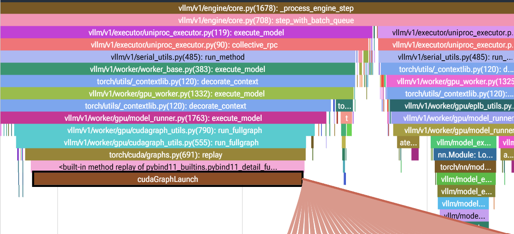
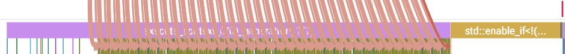
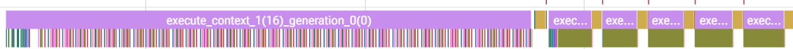

# LLM 量化實驗：W4A16 vs W8A8 on T4（Qwen2.5-3B + vLLM）

## 目錄

1. [前言](#1-前言)
   - [1.1 為什麼要量化](#11-為什麼要量化)
   - [1.2 Prefill 與 Decode：兩種截然不同的瓶頸](#12-prefill-與-decode兩種截然不同的瓶頸)
   - [1.3 量化在 NPU 上的好處](#13-量化在-npu-上的好處)
2. [實驗設定](#2-實驗設定)
   - [2.1 平台與模型](#21-平台與模型)
   - [2.2 比較的方法](#22-比較的方法)
   - [2.3 量測情境](#23-量測情境)
3. [實驗結果](#3-實驗結果)
   - [3.1 Prefill（compute-bound）](#31-prefillcompute-bound)
   - [3.2 Decode（memory-bound）](#32-decodememory-bound)
   - [3.3 Roofline 驗證（T4，BS = 1）](#33-roofline-驗證t4bs--1)
   - [3.4 精度評估（Perplexity）](#34-精度評估perplexity)
   - [3.5 速度、記憶體與精度綜合比較](#35-速度記憶體與精度綜合比較)
4. [啟用 Graph Mode 的好處](#4-啟用-graph-mode-的好處)
5. [結論與 NPU 啟示](#5-結論與-npu-啟示)
6. [限制與後續工作](#6-限制與後續工作)
7. [參考資料](#7-參考資料)

---

## 1. 前言

> 在沒有 NPU 的情況下，以 NVIDIA T4 作為替代平台，分別從 **Prefill（compute-bound）** 與 **Decode（memory-bound）** 兩個階段，驗證量化對延遲與記憶體的影響，並討論其在 NPU 上的意義。同時使用**activation outlier統計**與 **time profiling方法**分析 LLM 量化結果，做為改良方案依據。

### 1.1 為什麼要量化

LLM 推論的成本主要來自兩件事：**記憶體（容量與頻寬）** 與 **運算量**。以 Qwen2.5-3B 為例，FP16 權重約 6 GB；模型越大，單純「把權重從 DRAM 搬到運算單元」就足以成為瓶頸。

量化是把 FP16（16 bit）的權重與／或 activation 改用 INT8、INT4 表示，帶來兩種不同性質的收益：

| 量化型態 | 說明 | 省記憶體容量／頻寬 | 省運算 |
|---|---|:---:|:---:|
| **W4A16**（weight-only，如 [GPTQ](https://arxiv.org/abs/2210.17323)） | 權重 4 bit，activation 維持 FP16；計算前先 dequantize 回 FP16 | ✅ 約 4× | ❌（反而多 dequant 開銷） |
| **W8A8**（如 [SmoothQuant](https://arxiv.org/abs/2211.10438)） | 權重與 activation 皆 INT8，直接用 INT8 運算單元計算 | ✅ 約 2× | ✅ INT8 吞吐為 FP16 的 2×（T4：130 TOPS vs 65 TFLOPS） |

> [SmoothQuant](https://arxiv.org/abs/2211.10438) 的作用：activation 常有少數 outlier channel，直接量化到 INT8 誤差大。SmoothQuant 以 per-channel scale 把 activation 的量化難度「遷移」到權重上，使 W8A8 可行。

> [GPTQ](https://arxiv.org/abs/2210.17323) 的作用：對每個 linear layer 的權重**逐欄（column-wise）量化**；每量化完一欄，就用這一欄產生的量化誤差，乘上由校正資料估計出的（近似）Hessian 反矩陣，去更新、補償其餘尚未量化的欄位，使整層輸出的誤差最小化。這是一種 **weight-only、逐層校正**的量化方法，因此表格中屬於 W4A16（activation 不受影響，仍為 FP16）。

### 1.2 Prefill 與 Decode：兩種截然不同的瓶頸

| | **Prefill** | **Decode** |
|---|---|---|
| 處理方式 | 整段 prompt 平行處理（GEMM） | 每步只產生 1 個 token（GEMV），自回歸 |
| 算術強度（FLOP/Byte） | 約 `seq_len`，隨 prompt 變長而上升 | 約 1（BS=1） |
| 瓶頸 | **Compute-bound**（運算單元吞吐） | **Memory-bound**（權重讀取頻寬） |
| 延遲估算 | `2 × seq_len × params / 算力` | `模型大小 / 記憶體頻寬`（每個 token 都要讀完整權重一次） |
| 對應指標 | TTFT（首 token 延遲） | tokens/s |
| 量化的收益來源 | **低精度運算單元**（需 W8A8） | **少讀 bytes**（W4A16、W8A8 皆有效） |
| weight-only 量化 | 無益，甚至因 dequant 而變慢 | 接近線性加速 |

[Roofline](https://doi.org/10.1145/1498765.1498785) 參考（T4）：FP16 ridge point ≈ 65 TFLOPS ÷ 320 GB/s ≈ 200 FLOP/Byte，INT8 ≈ 130 TOPS ÷ 320 GB/s ≈ 400 FLOP/Byte。Decode（約 1 FLOP/Byte）遠在 ridge point 左側，完全由頻寬決定；prompt 長到數百 token 以上，prefill 才逐漸進入 compute-bound 區。

> **附註：Linear layer GEMM 的算術強度（Arithmetic Intensity）怎麼來的？**
>
> Transformer 的主要運算是 linear layer：`Y[M×N] = X[M×K] · W[K×N]`，其中 `M` 是一次處理的 token 數（prefill：`M = seq_len`；decode：`M = batch size = 1`）。
>
> - **Operation 數**：每個 MAC（乘加）= 1 次乘法 + 1 次加法 = **2 operations**，整個 GEMM 共 `2·M·K·N` operations。
> - **搬運 Bytes**：`M` 小於 `K`、`N` 時，主要搬運量是權重 `K·N·b_w`（`b_w` 為每個權重的 Byte 數：FP16 = 2、INT8 = 1、INT4 = 0.5），activation 的 `M·K`、`M·N` 相對很小。
> - **算術強度** = `2·M·K·N ÷ (K·N·b_w)` = **`2M / b_w`（operation / Byte）**。
>
> 也就是「每個權重搬進來（`b_w` Byte），可做 `2M` 個 operation」：權重被 `M` 個 token 重用 `M` 次，每次 2 個 operation。
>
> | 權重格式 | `b_w`（Byte） | Decode（`M = 1`） | Prefill（`M = 1207`） | Prefill 進入 compute-bound 的 `M`* |
> |---|:--:|:--:|:--:|:--:|
> | FP16（W16A16） | 2 | **1 op/Byte** | 1207 op/Byte | ≈ 200 |
> | INT8（W8A8，對照 INT8 算力） | 1 | 2 op/Byte | 2414 op/Byte | ≈ 200 |
> | INT4 權重（W4A16，對照 FP16 算力） | 0.5 | 4 op/Byte | 4828 op/Byte | ≈ 50 |
>
> \* 以 T4 規格峰值估算：`M* = ridge point × b_w ÷ 2`（FP16 ridge ≈ 203、INT8 ridge ≈ 406 op/Byte）。實際可持續算力低於規格峰值，真實轉折點會更早出現。
>
> 從這張表可以得到三個「硬體視角」的結論：
>
> 1. **Decode 每個 FP16 權重只換到 2 個 operation（1 op/Byte）**，而 T4 需要約 200 op/Byte 才能餵飽運算單元，所以運算單元幾乎閒置，效能 100% 由頻寬決定。
> 2. **量化縮小 `b_w`，等於把工作點沿 roofline 往右移**：W4 的算術強度是 FP16 的 4 倍，但 decode 的 4 op/Byte 仍遠小於 ridge point，**依然是 memory-bound**，所以加速比≈權重縮小倍率（見 3.2 節）。
> 3. **權重越小，越早進入 compute-bound**：W4A16 約 50 tokens 就會轉為 compute-bound，之後運算量不變、還要多做 dequantize，所以 prefill 沒有收益（見 3.1 節）。

### 1.3 量化在 NPU 上的好處

對 NPU 這類 ASIC 而言，量化不只是演算法技巧，而是直接決定 **PPA（Power、Performance、Area）** 三項指標的設計選擇。下表是 45 nm 製程下各種操作的能耗與面積（絕對值隨製程而變，但**比例關係**在各製程大致相近）：

| 操作 | 能耗 (pJ) | 面積 (µm²) |
|---|--:|--:|
| 8-bit INT add | 0.03 | 36 |
| 32-bit INT add | 0.1 | 137 |
| 8-bit INT mult | 0.2 | 282 |
| 16-bit FP add | 0.4 | 1,360 |
| 16-bit FP mult | 1.1 | 1,640 |
| 32-bit FP mult | 3.7 | 7,700 |
| 32-bit SRAM read（8 KB） | 5 | – |
| 32-bit DRAM read | **640** | – |

> 來源：能耗為 Mark Horowitz, [*Computing's Energy Problem (and what we can do about it)*](https://doi.org/10.1109/ISSCC.2014.6757323), ISSCC 2014（45 nm）；面積為 TSMC 45 nm 合成結果（引自 [Bill Dally 的 MICRO-52 keynote](https://www.microarch.org/micro52/media/dally_keynote.pdf)）。

#### Power：能耗

- **運算能耗**：INT8 乘法 0.2 pJ vs. FP16 乘法 1.1 pJ（約 5.5×）；INT8 加法 0.03 pJ vs. FP16 加法 0.4 pJ（約 13×）。以「INT8 乘法 + INT32 累加」（約 0.3 pJ）對比「FP16 乘加」（約 1.5 pJ），**一次 MAC 的能耗約降為 1/5**。
- **資料搬運能耗才是大宗**：讀一個 32-bit 字從 DRAM 要 640 pJ，是 8 KB SRAM 的 128 倍。折算成一個 INT8 權重（1 Byte）約 160 pJ，比一次 INT8 MAC（約 0.3 pJ）高出 **2–3 個數量級**。
- **Decode（BS = 1）每個權重只用一次，沒有重用**，每個 token 的能耗幾乎由 DRAM 搬運量決定，近似正比於權重 Byte 數：**相對 FP16，W8 ≈ 1/2、W4 ≈ 1/4**。這正是 1.2 節附註中 1 op/Byte 的能量意義：搬 1 Byte 的能量，遠大於對它做 1 個 operation 的能量。
- 邊緣裝置有電池與散熱上限（功耗 envelope），能耗直接決定能否持續運行、能跑多快（thermal throttling）。

#### Performance：效能

- **Prefill（compute-bound）**：同樣的面積與功耗預算下，INT8 MAC 陣列可放更多 MAC，吞吐更高（T4：INT8 130 TOPS vs. FP16 65 TFLOPS；專用 NPU 的 INT8 優勢通常更大），直接降低 TTFT。
- **Decode（memory-bound）**：tokens/s ≈ 頻寬 ÷ 每 token 搬運的權重 Bytes，權重縮小多少倍，tokens/s 就大約提升多少倍。
- 邊緣 NPU 多使用 LPDDR，頻寬僅數十 GB/s 等級（T4 為 320 GB/s，資料中心 GPU 則是 TB/s 等級），decode 更嚴重 memory-bound，量化收益更明顯。

#### Area：面積

- **MAC 單元更小**：INT8 乘法器約 282 µm²，FP16 乘法器約 1,640 µm²（約 1/6）；INT8 加法器 36 µm²，FP16 加法器 1,360 µm²（約 1/38）。「INT8 乘 + INT32 累加」約 420 µm²，「FP16 乘加」約 3,000 µm²，**同樣面積可放約 7 倍的 MAC，或在相同算力下省下大量面積（成本）**。
- **On-chip SRAM 的等效容量變大**：SRAM 通常占 NPU 面積的大宗。4-bit 權重讓同樣大小的 SRAM 容納 4 倍的權重，可使用更大的 tile、提高重用，減少 DRAM 往返。
- **DRAM 介面**：頻寬需求降低後，可用較窄或較慢的記憶體介面達到相同 tokens/s，節省 PHY / controller 的面積與 IO 功耗。
- **注意 weight-only（W4A16）的面積代價**：它仍需要 FP16 MAC 與 dequantize 邏輯，只省了儲存與搬運，**沒有省下 MAC 面積與運算能耗**；W8A8（以及 W4A8）則可以讓資料路徑全程使用整數運算，省下 FP16 資料路徑。

#### PPA 總結

| PPA | 量化帶來的效果 | 主要受益階段 | 需要的量化型態 |
|---|---|---|---|
| **Power** | 少搬 DRAM Bytes；低位元運算降低每次 MAC 能耗 | Decode（搬運主導）、Prefill（運算主導） | 搬運：W4A16 / W8A8；運算：W8A8 |
| **Performance** | INT8 MAC 吞吐更高；少讀 Bytes 提升 tokens/s | Prefill：TTFT；Decode：tokens/s | Prefill：W8A8；Decode：W4A16 / W8A8 |
| **Area** | MAC 更小、等效 SRAM 容量變大、DRAM 介面可縮減 | 兩者皆有 | W8A8（可省 FP16 資料路徑） |

此外，**容量限制**也是邊緣裝置的關鍵：DRAM 有限，量化讓更大的模型得以放入，並留出更多空間給 KV cache。

由此可得到一個自然的策略：**Prefill 追求算力 → W8A8；Decode 追求頻寬 → W4A16 或 W8A8**。以下實驗即在 T4 上驗證這個推論。

---

## 2. 實驗設定

### 2.1 平台與模型

| 項目 | 內容 |
|---|---|
| GPU | NVIDIA T4 16 GB（FP16 65 TFLOPS、INT8 130 TOPS、記憶體頻寬 320 GB/s） |
| 模型 | [Qwen/Qwen2.5-3B](https://arxiv.org/abs/2412.15115) |
| 推論框架 | [vLLM](https://arxiv.org/abs/2309.06180) |
| vLLM 設定 | `enforce_eager=False`（啟用 CUDA graph）、`enable_prefix_caching=False`（關閉 prefix caching） |
| Attention backend | `TRITON_ATTN` |
| Batch size | 1 |
| 量化工具 | [llm-compressor](https://github.com/vllm-project/llm-compressor) |

**vLLM 參數說明**

| 參數 | 設定值 | 作用 | 為什麼這樣設定 |
|---|:--:|---|---|
| `enforce_eager` | `False` | 啟用 **CUDA graph**：vLLM 在啟動時預先 capture decode 步驟的整串 GPU kernel，之後每一步只需一次 replay；若為 `True`（eager 模式），每一步都由 CPU 逐一 launch 數百個 kernel | BS = 1、模型小時，eager 模式的 CPU launch 開銷會成為瓶頸，遮蔽記憶體頻寬與算力的真實差異。設為 `False` 才能反映 GPU 端的 compute / memory 行為（代價是啟動較慢、多佔一些記憶體） |
| `enable_prefix_caching` | `False` | 關閉 **[prefix caching](https://docs.vllm.ai/en/latest/features/automatic_prefix_caching/)**：開啟時，vLLM 會把已算過的 prompt 前綴 KV cache 保存起來，後續請求若前綴相同就直接重用、跳過那段 prefill（較新版本的 vLLM 預設為開啟） | 本實驗要量測的是**完整的 prefill 運算**。若開啟，重複量測相同 prompt 時 prefill 會被 cache 命中，量到的就不是真正的 prefill 延遲 |

> T4 不是 NPU，但它具備 INT8 Tensor Core（INT8 吞吐為 FP16 的 2×），與多數 NPU「INT8 優於 FP16」的特性相近，適合作為行為預演。差異在於 T4 頻寬（320 GB/s）高於多數邊緣 NPU，因此 decode 的絕對 tokens/s 不可直接外推。

### 2.2 比較的方法

| 簡稱 | 方法 | 權重大小 |
|---|---|---:|
| FP16 | baseline | 6.0 GB |
| GPTQ | W4A16，llm-compressor default recipe | 1.9 GB |
| SmoothQuant (O3) | W8A8，SmoothQuant O3（llm-compressor default mapping，**不含 `o_proj`、`down_proj` 的 smoothing**） | 3.2 GB |
| SmoothQuant (O3 + ignore_dproj) | 同上，但 `down_proj` 不量化（保留 FP16） | 3.9 GB |

> **llm-compressor SmoothQuant default 的 mapping**：SmoothQuant 把 linear layer `Y = X·W` 改寫為 `Y = X̂·Ŵ`（`X̂ = X·diag(s)⁻¹`、`Ŵ = diag(s)·W`），其中 `diag(s)⁻¹` 需離線併進產生 `X` 的運算（LayerNorm 或 Linear），推論時才不會多出運算。
> default mapping 只涵蓋 `(q_proj, k_proj, v_proj) ← input_layernorm` 與 `(gate_proj, up_proj) ← post_attention_layernorm`，**不包含 `o_proj` 與 `down_proj`** 這兩個 linear layer，因此它們的 activation outlier 沒有被平滑就直接做 INT8 量化。這是 3.4 節精度問題的主要背景（原因詳見 3.4 節的 mapping 註解）。

### 2.3 量測情境

| 情境 | 設定 | 量測內容 |
|---|---|---|
| **Prefill** | prompt = 150 / 293 / 545 / 1207 tokens，僅生成 1 token | 延遲（≈ TTFT） |
| **Decode** | prompt = 545 tokens，生成 512 tokens | 總延遲、生成 tokens/s |

- **Speedup** = FP16 延遲 ÷ 量化後延遲。
- **Memory** = 推論期間 GPU 記憶體峰值扣除 baseline（`gpu_memory_peak − gpu_memory_baseline`）。
- **Saving** = FP16 記憶體 ÷ 量化後記憶體。

---

## 3. 實驗結果

### 3.1 Prefill（compute-bound）

```
BS = 1，生成 1 token；Latency 單位 ms，Memory 單位 GB
```

| BS | SeqLen | Latency FP16 (ms) | Latency Ours (ms) | Speedup (↑) | Memory FP16 (GB) | Memory Ours (GB) | Saving (↑) |
|:--:|:--:|--:|--:|:--:|--:|--:|:--:|
| **Qwen2.5-3B · GPTQ (W4A16)** | | | | | | | |
| 1 | 150 | 102 | 86 | 1.18× | 7.59 | 3.02 | 2.51× |
| 1 | 293 | 162 | 158 | 1.03× | 7.49 | 3.03 | 2.47× |
| 1 | 545 | 257 | 276 | 0.93× | 7.51 | 3.05 | 2.46× |
| 1 | 1207 | 676 | 750 | 0.90× | 7.56 | 3.11 | 2.43× |
| **Qwen2.5-3B · SmoothQuant O3 (W8A8)** | | | | | | | |
| 1 | 150 | 102 | 59 | 1.72× | 7.59 | 4.40 | 1.73× |
| 1 | 293 | 162 | 92 | 1.76× | 7.49 | 4.41 | 1.70× |
| 1 | 545 | 257 | 172 | 1.49× | 7.51 | 4.44 | 1.69× |
| 1 | 1207 | 676 | 483 | 1.40× | 7.56 | 4.45 | 1.70× |
| **Qwen2.5-3B · SmoothQuant O3 + ignore_dproj (W8A8)** | | | | | | | |
| 1 | 150 | 102 | 63 | 1.60× | 7.59 | 5.05 | 1.50× |
| 1 | 293 | 162 | 93 | 1.74× | 7.49 | 5.06 | 1.48× |
| 1 | 545 | 257 | 176 | 1.46× | 7.51 | 5.09 | 1.48× |
| 1 | 1207 | 676 | 501 | 1.35× | 7.56 | 5.15 | 1.47× |


**結果解讀**

- **W8A8（SmoothQuant）在 prefill 全面加速 1.35×–1.76×**：prefill 受限於運算，W8A8 能直接使用 T4 的 INT8 Tensor Core（理論 2× FP16），因此有明確收益。實測未達 2×，推測原因有三：(1) attention、norm、量化／反量化等非 GEMM 部分仍是 FP16；(2) 存在**固定開銷**，包含把權重從記憶體（DRAM → L2／shared memory → register／flip-flop）搬到運算單元所需的時間，以及 kernel launch、排程等，這部分不會隨運算精度等比例縮小；(3) KV cache 儲存。
- **W4A16（GPTQ）的 prefill 加速隨 prompt 變長而消失，甚至變慢（0.90×）**：weight-only 量化沒有降低運算量，計算前還需把 4 bit 權重 dequantize 回 FP16。prompt 短（150）時，計算時間短，把權重搬到運算單元的固定開銷占比高，4 bit 權重少搬一些，因此有些許助益；prompt 一長，進入 compute-bound，dequant 的額外開銷大於省下的搬運時間，因此反而變慢。這與 1.2 節的預期一致。
- **W8A8 的 Speedup 隨 SeqLen 增加而下降**：SeqLen 越大，attention 的占比越高，而 attention 並未被量化；150 tokens 時則因固定開銷占比最高，加速略低於 293 tokens。
- **記憶體節省約 1.5×–2.5×**：低於權重本身的壓縮倍率，原因是 embedding／lm_head 仍為 FP16（約 0.6 GB），且 activation、框架本身的記憶體不受量化影響。

### 3.2 Decode（memory-bound）

```
BS = 1，prompt 545 tokens，生成 512 tokens；Latency 為整段總延遲
```

| BS | SeqLen | Latency FP16 (ms) | Latency Ours (ms) | Speedup (↑) | Memory FP16 (GB) | Memory Ours (GB) | Saving (↑) |
|:--:|:--:|--:|--:|:--:|--:|--:|:--:|
| **Qwen2.5-3B (T4 16GB)** | | | | | | | |
| 1 | 545 + 512 | 23,540 | 7,429 (GPTQ, W4A16) | **3.17×** | 8.25 | 3.05 | 2.70× |
| 1 | 545 + 512 | 23,540 | 12,834 (SmoothQuant O3, W8A8) | **1.83×** | 8.25 | 4.35 | 1.90× |
| 1 | 545 + 512 | 23,540 | 12,831 (SmoothQuant O3 + ignore_dproj) | **1.83×** | 8.25 | 5.09 | 1.62× |

生成吞吐量：

| 方法 | 生成 tokens/s | 相對 FP16 |
|---|--:|:--:|
| FP16 | 21.75 | 1.00× |
| GPTQ (W4A16) | 68.92 | 3.17× |
| SmoothQuant O3 (W8A8) | 39.89 | 1.83× |
| SmoothQuant O3 + ignore_dproj | 39.90 | 1.83× |

**結果解讀**

- **Decode 加速幾乎等於「權重變小的倍率」**：BS=1 時每個 token 都必須讀完整份權重，延遲由讀取量決定。下表以實際權重大小（含 FP16 的 embedding／lm_head）檢驗：

| 方法 | 權重大小 | 相對 FP16 縮小倍率 | 實測 Decode Speedup |
|---|--:|:--:|:--:|
| GPTQ (W4A16) | 1.9 GB | 3.16× | 3.17× |
| SmoothQuant O3 (W8A8) | 3.2 GB | 1.88x | 1.83× |

- **W4A16 是 decode 的最佳選擇**：4 bit 權重讀取量最少，tokens/s 提升最多（3.17×）。
- **W8A8 在 decode 只有約 1.8×**：decode 階段 INT8 運算單元用不上（算力閒置），收益只來自權重縮小為 1/2。
- 注意 3B 模型的權重不只有 transformer 層：embedding／lm_head（約 0.6 GB，FP16）每個 token 仍要讀取，所以「4 bit」實際上只帶來約 3× 而非 4×。

### 3.3 Roofline 驗證（T4，BS = 1）

**Decode：實測 vs. 理論頻寬下限**

| 方法 | 權重大小 (GB) | 理論下限 = 大小 ÷ 320 GB/s (ms/token) | 實測 (ms/token) | 頻寬使用率 |
|---|--:|--:|--:|--:|
| FP16 | 6.0 | 18.8 | 45.6 | 41% |
| GPTQ (W4A16) | 1.9 | 5.9 | 14.0 | 42% |
| SmoothQuant O3 (W8A8) | 3.2 | 10.0 | 24.8 | 40% |

三種方法的頻寬使用率相近（約 40–42%），代表 decode 確實落在同一條「頻寬屋頂」上，差異幾乎完全來自讀取量。剩餘的差距來自 kernel launch、attention／KV cache 讀取、sampling 與 CPU 端排程等固定開銷，以及 T4 實際可用頻寬低於 320 GB/s 的規格值。

> 實測 ms/token = (生成 512 tokens 的總延遲 − 同 prompt 的 prefill 延遲) ÷ 511。

**Prefill：實測 vs. 理論算力下限（prompt = 1207）**

| 方法 | 運算量 (TFLOP) | 使用算力 | 理論下限 (ms) | 實測 (ms) | 算力使用率 |
|---|--:|--:|--:|--:|--:|
| FP16 | 7.24 | 65 TFLOPS | 111 | 676 | 16% |
| SmoothQuant O3 (W8A8) | 7.24 | 130 TOPS | 56 | 483 | 12% |

> 運算量 = `2 × seq_len × n_params`，以 3B 參數估算。T4 功耗上限僅 70 W，持續算力遠低於規格峰值，且延遲包含固定開銷，因此使用率偏低屬預期。

### 3.4 精度評估（Perplexity）

**評估設定**

| 項目 | 內容 |
|---|---|
| 評估資料集 | [WikiText-2](https://arxiv.org/abs/1609.07843) (raw) **test** split |
| 評估方式 | 沿用 [SmoothQuant 論文](https://arxiv.org/abs/2211.10438)的 perplexity 評估做法：整份 test set 以 `\n\n` 串接後 tokenize，連續切成不重疊的 chunk（每塊 512 tokens），逐 chunk 計算 NLL |
| 實作 | vLLM `prompt_logprobs`，只做一次 prefill（`max_tokens=1`），累加每個 token 的 NLL；第 0 個 token 無 context，不計入 |
| 指標 | Avg NLL 與 Perplexity（`exp(Avg NLL)`），越低越好 |
| vLLM 設定 | `dtype=half`、`max_num_seqs=1`、`enforce_eager=False`、`enable_prefix_caching=False`、`TRITON_ATTN` |

所有模型共用同一批 token，因此可直接比較相對 FP16 的退化幅度。

**Calibration 資料集**

| 項目 | 內容 |
|---|---|
| 資料集 | WikiText-2 (raw) **train** split（與評估用的 test split 不重疊） |
| 前處理 | 與評估相同：以 `\n\n` 串接 → tokenize（不加 special tokens）→ 切成不重疊的 block |
| Calibration seq len | 512 tokens（每個 block 長度） |
| 樣本數（# Samples） | 128（default），另測 512 |
| 取樣方式 | block 以固定 seed（42）shuffle 後取前 N 個，確保各組實驗使用同一批資料 |
| 量化流程 | llm-compressor `oneshot` |

名詞說明：`ignore_dproj` 為 `down_proj` 不量化（保留 FP16）；`mapping (down_proj, up_proj)` 為手動指定的 SmoothQuant mapping（見下方註解）。

| 模型 | Recipe | Calibration seq len | # Samples | Avg NLL | PPL (↓) | ΔPPL vs FP16 |
|---|---|:--:|:--:|--:|--:|--:|
| FP16 | baseline | – | – | 2.4633 | 11.74 | – |
| GPTQ (W4A16) | default | 512 | 128 | 2.5457 | 12.75 | +8.6% |
| SmoothQuant O1 (W8A8) | default | 512 | 128 | 2.5461 | 12.76 | +8.6% |
| SmoothQuant O3 (W8A8) | default | 512 | 128 | 2.9687 | 19.47 | +65.8% |
| SmoothQuant O3 (W8A8) | default | 512 | 512 | 3.0614 | 21.36 | +81.9% |
| SmoothQuant O3 (W8A8) | mapping (down_proj, up_proj) | 512 | 128 | 2.8270 | 16.90 | +43.9% |
| SmoothQuant O3 (W8A8) | ignore_dproj | 512 | 128 | 2.4874 | **12.03** | **+2.4%** |

#### 為什麼優先處理 `down_proj`：逐層 activation 統計

優先處理 `down_proj` 這一層，是因為逐層分析顯示：在前幾層（layer 2、3）與較後面的層（layer 33、35），`down_proj` 有比其他層明顯更大的 activation outlier。下表為各 linear layer 輸入 activation 的統計，依 `max_abs` 排序，列出前 8 名：

| module | mean | std | max_abs | p99 | p99.9 | p99.99 | max_abs ÷ p99.99 |
|---|--:|--:|--:|--:|--:|--:|--:|
| layer_2.mlp.down_proj | 0.0685 | 1.503 | **1975.4** | 0.382 | 1.208 | 3.230 | ≈ 612× |
| layer_33.mlp.down_proj | 0.2277 | 1.700 | **1872.7** | 1.585 | 5.250 | 13.207 | ≈ 142× |
| layer_3.mlp.down_proj | 0.0789 | 1.114 | **1043.3** | 0.408 | 1.150 | 3.224 | ≈ 324× |
| layer_3.mlp.up_proj | 0.6876 | 0.989 | 336.4 | 2.786 | 8.775 | 13.110 | ≈ 26× |
| layer_3.mlp.gate_proj | 0.6876 | 0.989 | 336.4 | 2.781 | 8.634 | 13.036 | ≈ 26× |
| layer_33.mlp.gate_proj | 1.1084 | 1.290 | 256.8 | 5.332 | 12.855 | 20.783 | ≈ 12× |
| layer_33.mlp.up_proj | 1.1084 | 1.290 | 256.8 | 5.187 | 13.043 | 23.874 | ≈ 11× |
| layer_35.mlp.down_proj | 0.3964 | 1.417 | 198.6 | 5.475 | 21.262 | 47.388 | ≈ 4× |

觀察：

- 前 8 名中有 4 個是 `down_proj`（layer 2、33、3、35），且 `max_abs` 前三名全是 `down_proj`（約 1000–2000）；其他層的 `max_abs` 多在數百以下。
- `down_proj` 的 outlier 是**極端稀疏的**：layer 2 的 p99.99 只有 3.2，`max_abs` 卻是 1975（約 600 倍）。也就是絕大多數值很小，只有極少數值極大，INT8 的 scale 若被這些極少數值撐大，其餘正常值的解析度會被嚴重壓縮。
- `gate_proj` 與 `up_proj` 共用同一個輸入（`post_attention_layernorm` 的輸出），所以兩者統計相同；這個輸入已被 SmoothQuant default mapping 涵蓋（見下方註解），而 `down_proj` 的輸入不在 default mapping 內。

這與上方 PPL 表一致：`down_proj` 不量化（`ignore_dproj`）即可使 PPL 由 19.47 回到 12.03。

#### 註：SmoothQuant 的 mapping，為什麼 default 不含 `o_proj`、`down_proj`

llm-compressor 的 SmoothQuant default 設定**不包含 `o_proj`、`down_proj` 這兩個 linear layer 的 smoothing**，若要處理，需手動指定 activation / weight 的 mapping。要理解原因，先看 SmoothQuant 的運作條件。

**SmoothQuant 的融合條件**

SmoothQuant 對 linear layer `Y = X·W` 引入逐 channel 的 smoothing factor `s`，並做數學上等價的改寫：

$$Y = \big(X\,\mathrm{diag}(s)^{-1}\big)\big(\mathrm{diag}(s)\,W\big) = \hat{X}\hat{W}$$

- `X̂ = X·diag(s)⁻¹`：activation 的 outlier channel 被縮小，變得容易量化。
- `Ŵ = diag(s)·W`：縮小的倍率轉移給權重，可離線算好。
- **關鍵在 `X̂`**：若推論時才計算 `X·diag(s)⁻¹`，會多出一次逐 channel 的運算。但 `X` 通常是前面的運算（linear layer、layer norm 等）的輸出，`diag(s)⁻¹` 可離線併進該運算的參數，讓它直接輸出 `X̂`，推論時沒有額外開銷（見原論文式 (3) 之後的說明）。

所以一個 linear layer 能否被 smoothing，取決於：**產生 `X` 的運算，其輸出 channel 能否被精確地逐 channel 縮放，且 channel 數與 `X` 一致。**

| 要 smoothing 的層（`Y = X·W`） | `X` 的內容 | 產生 `X` 的運算（`1/s` 併入此處） | 狀態 |
|---|---|---|---|
| `q_proj`、`k_proj`、`v_proj` | `input_layernorm` 輸出 | `input_layernorm` 權重 | ✅ default 已包含 |
| `gate_proj`、`up_proj` | `post_attention_layernorm` 輸出 | `post_attention_layernorm` 權重 | ✅ default 已包含 |
| `o_proj` | attention 輸出 `O = P·V`（`P = softmax(QKᵀ/√d_k)`） | `v_proj` 的輸出 channel | ⚠️ 數學上成立，但 GQA 下維度不符，無法套用 |
| `down_proj` | `silu(gate) ⊙ up` | `up_proj` 的輸出 | ✅ 可精確融合，但 default 未包含，需手動指定 |

**`o_proj`：數學可行，但 GQA 使它難以實作**

- **數學上成立**：`o_proj` 的輸入 `X` 就是 attention 的輸出 `O`。以單一 head 為例：

  $$P = \mathrm{softmax}\!\left(\frac{Q K^{\top}}{\sqrt{d_k}} + M\right),\qquad O = P\,V,\qquad Y = O\,W_o$$

  - `Q, K, V ∈ ℝ^{n×d}`，`n` 為序列長度，`M` 為 causal mask。
  - `P ∈ ℝ^{n×n}` 是 attention 權重，**softmax 是對每個 query 在「序列（key 位置）維度」上做 row-wise 正規化**，只與 `Q`、`K` 有關，不涉及 `V` 的 channel，也不會混合 channel。
  - `P` 從**左邊**乘 `V`（混合序列位置），`diag(s)⁻¹` 從**右邊**乘（縮放 channel），兩者互不干擾：

  $$(P\,V)\,\mathrm{diag}(s)^{-1} = P\,\big(V\,\mathrm{diag}(s)^{-1}\big)$$

  此處 `X = O`，左式即 `X̂`；右式表示等於把 `v_proj` 輸出的每個 channel 除以 `s`，是精確的轉換。RoPE 只作用在 `Q`、`K`，不受影響。融合時要注意 Qwen2.5 的 `v_proj` **有 bias**，bias 也必須一起除以 `s`。
- **[GQA](https://arxiv.org/abs/2305.13245) 讓它變麻煩**：Qwen2.5-3B 有 16 個 query head、2 個 KV head（head_dim = 128）。`o_proj` 的輸入有 2048 個 channel，`v_proj` 的輸出卻只有 256 個，**每個 V channel 會被同組 8 個 query head 共用**（KV head `g` 的第 `c` 個 channel，同時出現在該組 8 個 query head 輸出 `O` 的第 `c` 個 channel 中）。
  - 融合要求這 8 個對應 channel 的 `s` 必須相同，**不能像標準 SmoothQuant 那樣每個 channel 獨立計算 scale**（例如要改取組內最大值），smoothing 的彈性因此下降。
  - llm-compressor 的 mapping 假設兩邊 channel 數一一對應，對 GQA 的 `o_proj` 會因維度不符而失敗。
  - MHA 模型（Q、K、V head 數相同）沒有這個問題。

**`down_proj`：可精確融合進 `up_proj`**

- 輸入為 `silu(gate) ⊙ up`。`silu` **不是齊次函數**（`silu(g/s) ≠ silu(g)/s`），所以不能把 `1/s` 融合進 `gate_proj`。
- 但 `up` 是線性的：

  $$\mathrm{silu}(g)\odot\frac{u}{s} = \frac{\mathrm{silu}(g)\odot u}{s}$$

  因此可精確地把 `1/s` 融合進 `up_proj` 輸出的對應 row（Qwen 的 MLP 沒有 bias，更單純）。
- 實驗結果：手動指定此 mapping（activation = `up_proj` 輸出、weight = `down_proj`）後，PPL 由 19.47 改善到 16.90，**雖有改善，但仍不理想**（+43.9%）。推測是 `down_proj` 的 activation outlier 太極端，把難度遷移給權重後，權重也變得難以量化，單靠 smoothing 無法完全解決，這也是最後 `ignore_dproj` 效果最好的原因。

**結果解讀**（GPTQ W4A16 僅作為對照基準，以下聚焦 SmoothQuant 的 PPL 優化）

- **SmoothQuant O3 default 的精度明顯崩壞（+65.8%）**：原因是 default mapping 沒有平滑 `o_proj`、`down_proj` 的 activation，outlier 直接被量化成 INT8。
- **增加 calibration 樣本數（128 → 512）反而更差（21.36）**：代表問題不在 calibration 資料量，而在特定層本身難以量化。
- **手動指定 `(down_proj, up_proj)` mapping 只能部分改善**（19.47 → 16.90，仍 +43.9%）：`down_proj` 的 activation outlier 無法僅靠 smoothing 充分消除，且 `o_proj` 仍無法 mapping。
- **`ignore_dproj`（`down_proj` 不量化）是關鍵**：PPL 回到 12.03（+2.4%），是所有量化組合中最佳，甚至優於 GPTQ default（12.75）。推測原因是 `down_proj` 的輸入（SwiGLU 輸出）存在極端 outlier（見上方逐層統計），對 INT8 activation 量化特別敏感。
- **代價**：`ignore_dproj` 使模型從 3.2 GB 增至 3.9 GB，decode 記憶體節省由 1.90× 降到 1.62×；速度幾乎不變（decode 同為 1.83×，prefill 略慢約 0.05×）。

> 各組 PPL 差距較小者（例如 12.03 vs 12.75）為單次評估結果，未做重複量測，不宜過度解讀。

### 3.5 速度、記憶體與精度綜合比較

| 方法 | 權重大小 (GB) | PPL (↓) | ΔPPL | Prefill Speedup (150–1207 tokens) | Decode Speedup | Decode Memory Saving |
|---|--:|--:|--:|:--:|:--:|:--:|
| FP16 | 6.0 | 11.74 | – | 1.00× | 1.00× | 1.00× |
| GPTQ (W4A16) | 1.9 | 12.75 | +8.6% | 0.90×–1.18× | **3.17×** | 2.70× |
| SmoothQuant O3 (W8A8) | 3.2 | 19.47 | +65.8% | **1.40×–1.76×** | 1.83× | **1.90×** |
| SmoothQuant O3 + ignore_dproj (W8A8) | 3.9 | **12.03** | **+2.4%** | 1.35×–1.74× | 1.83× | 1.62× |

> PPL 取 calibration seq len = 512、128 samples 的結果，並假設與速度實驗的 default 設定一致。

- **SmoothQuant O3 預設設定速度與記憶體最好，但精度不可接受**；加上 `ignore_dproj` 後精度幾乎無損，只多付出 0.7 GB 記憶體。這是 W8A8 的實用選擇。
- **GPTQ 是 decode 的最佳選擇**（3.17×），但 prefill 長 prompt 不佔優勢，且 PPL 損失（+8.6%）高於 O3 + ignore_dproj。
- **依工作負載選擇**：prefill 為主（長 prompt、RAG、摘要）→ W8A8 + `ignore_dproj`；生成為主（對話、長輸出）→ W4A16。

---

## 4. 啟用 Graph Mode 的好處

本報告的所有速度量測皆設定 `enforce_eager=False`（見 2.1 節），也就是啟用 **CUDA Graph**。這一節說明這個設定實際在 compile 什麼、對效能的影響是什麼。

### 4.1 在 compile 什麼

`enforce_eager=True`（eager 模式）下，每一次 decode，CPU 端的 Python／PyTorch 都要重新走一遍模型的每一層、每一個算子，逐一呼叫 `cudaLaunchKernel` 把工作交給 GPU。

`enforce_eager=False` 時，vLLM 會在**引擎啟動階段**（載入權重之後、開始接受任何真正的請求之前）做一段專門的 **warmup／capture**：用假資料（dummy input）模擬出一系列固定 batch size 的 **decode 形狀**（每個序列只產生 1 個 token），對每個 batch size 各跑一次 forward，並把這次**模型 forward** 的 **GPU kernel 呼叫序列**（kernel 本身、執行參數、記憶體位址）錄製成一張 **CUDA Graph**（範圍是 embedding → 各 decoder layer → final norm，輸出 hidden states；`lm_head` 與 sampling 不在 graph 內，見 4.2 節附註）。

幾個容易混淆的點：

- **不是在你送出的第一個真正請求時才錄製**：capture 在服務開始之前就已經做完，你送出的第一個請求（不論是 prefill 或 decode）用到的都已經是錄好的 graph（如果該 batch size 有被 capture 到）。
- **錄的是 decode 形狀，不是 prefill 形狀**：decode 每步只產生 1 個 token，shape 只隨 batch size 變化，batch size 的組合有限（例如 1、2、4、8…），所以可以針對每個 batch size 各錄一張圖。Prefill 的 shape 會隨 prompt 長度（token 數）大幅變動，傳統上無法用這種「固定 shape 各錄一張」的方式整段 capture，所以 vLLM 的 CUDA graph 主要針對 decode 步驟。

這也解釋了 vLLM profiler 的現象：你看到第一個 token（prefill）的 call stack 裡有 `cuda_graph.py: __call__`、`piecewise_backend` 等呼叫，是因為那段路徑走的是**編譯（torch.compile）後的 piecewise 區塊**，而不是 decode graph 的 capture 過程——decode graph 早在你開始送請求、甚至開始錄 profiler trace之前，就已經錄好了。

### 4.2 之後每一步：一次發射整張 Graph

錄製完成後，之後每個 decode step，CPU 端不再逐一呼叫上百個 kernel，而是：

1. 把這一步的輸入資料複製到錄製時固定好的記憶體位址（static buffer）。
2. 呼叫**一次** `cudaGraphLaunch`。

GPU 收到這一次呼叫後，會依照錄製好的順序**接連執行整串 kernel**，不需要 CPU 再介入。

下面兩張圖由 **vLLM profiler** 錄製 trace，再以 [Perfetto UI](https://ui.perfetto.dev/) 開啟後截圖而得：圖 1 為 **CPU 端**，圖 2 為 **GPU 端**。

**圖 1：CPU 端。** 黑框標記處是 CPU 呼叫 `cudaGraphLaunch` 的瞬間，往右下延伸的一整排紅色線（Perfetto 的 flow event）連到這一次呼叫在 GPU 端觸發的大量 kernel：



**圖 2：GPU 端。** 紅色線的終點是 GPU 上一長串緊密相連的小 kernel，全部由圖 1 的那一次 `cudaGraphLaunch` 觸發：



> 圖 1、圖 2：CPU 端一次 `cudaGraphLaunch` 對應到 GPU 端一長串連續執行的 kernel，這就是「一次發射整張 CUDA graph」。

> **附註：`lm_head` 不在 graph 內。** 在上圖的 GPU 端，graph 的 kernel 序列之後還有 graph 以外的 kernel（圖 2 右側）。原因是 vLLM（V1）只把「模型 forward」放進 graph，輸出的是 hidden states；之後 model runner 會先依 `logits_indices` 取出需要取樣的位置，再另外呼叫 `compute_logits`（`lm_head` + logits processor）與 sampler，這段是以一般方式由 CPU 逐一 launch，不在被錄製的 graph 之內（圖 1 右側 graph 之後那一排逐一發射的 kernel 即屬此類）。可能的原因是：取樣位置的數量與索引每一步都不同（prefill 時只取最後一個 token、decode 時依 batch 而定），且 sampling 含有隨機性與 CPU 端邏輯，不適合固定成靜態 graph。此行為依 vLLM 版本而異。

### 4.3 為什麼這對 decode 特別重要

Decode 階段每個 kernel 的執行時間都很短，如果每個 kernel 都要先讓 CPU 走一次 Python／dispatcher 的流程才能 launch，CPU 發射的速度容易跟不上 GPU 執行的速度，GPU 便會出現等待 CPU 的空檔。

Graph mode 把「CPU 需要介入的次數」從「每個 kernel 一次」降為「每個 decode step 一次」，讓 GPU 端的 kernel 可以緊密相連地執行，不被 CPU 的 dispatch 開銷拖慢。這也是 2.1 節選擇 `enforce_eager=False` 的原因：避免 CPU launch overhead 遮蔽掉本報告真正想量測的 GPU 端 compute／memory 行為差異。

下圖同樣由 vLLM profiler 錄製、以 [Perfetto UI](https://ui.perfetto.dev/) 開啟後截圖，是 **GPU 端 kernel 的執行情況**，左側為 prefill，右側為後續的 decode：



> 圖 3：GPU 端的 kernel 執行情況。左側的長區塊是 prefill，共花約 **120 ms**，kernel 之間有許多空閒等待；右側是後續的 decode，每一步只花約 **6 ms**，kernel 之間幾乎沒有空閒。

- **Prefill（約 120 ms）**：GPU kernel 之間有明顯的空白，代表 GPU 在等待。推測與 prefill 不是以整張 CUDA graph 重播有關（見 4.1 節：graph 主要針對 decode 形狀），而是由 CPU 逐一發射 kernel，但此點尚未經 profiling 驗證。
- **Decode（約 6 ms／步）**：整串 kernel 由一次 `cudaGraphLaunch` 觸發，kernel 緊密相連、幾乎沒有空閒，GPU 的時間幾乎都花在實際計算與記憶體搬運上，這正是 decode 能反映頻寬瓶頸的原因。
- profiler 本身有額外開銷，圖中的絕對時間僅用來對照 prefill 與 decode 的相對型態，不等同 3.1、3.2 節的實測延遲。

### 4.4 為什麼端側 NPU 更適合 Graph Mode

在 GPU 上，graph mode 是「有 eager 模式可退、視情況選用」的加速手段；但在端側 NPU 上，靜態圖幾乎是必要路徑，原因比 GPU 更根本：

- **CPU 端 dispatch 開銷占比更高**：手機／邊緣裝置的 CPU 主頻遠低於伺服器 CPU，而 NPU 單層的計算時間也更短，使得「CPU 逐層發射」的相對開銷比 GPU 上更嚴重；NPU 的 driver/runtime（如 QNN、NeuroPilot）逐層下發指令的路徑通常也比 CUDA driver 更長。
- **NPU 硬體本身依賴編譯期已知的靜態圖**：NPU 的記憶體配置（on-chip SRAM／scratchpad 佈局）、算子排程與融合，多半在編譯期就決定好，而不是像 PyTorch eager 那樣在 runtime 現場動態決定。這也是為什麼主流 NPU 工具鏈（TFLite delegate、ExecuTorch backend、QNN、NeuroPilot）幾乎都要求先把模型轉成固定 shape、固定 op 序列的靜態圖才能編譯部署，沒有「eager 模式」這個退路。
- **功耗是端側的硬指標**：CPU 頻繁喚醒去 dispatch，會讓系統難以進入低功耗狀態，也可能讓 NPU 無法維持穩定頻率；靜態圖讓整段推論用最少的 CPU 喚醒次數跑完，直接影響電池續航。

---

## 5. 結論與 NPU 啟示

| 階段 | 瓶頸 | 有效的量化 | T4 實測 | 對 NPU 的意義 |
|---|---|---|---|---|
| **Prefill** | Compute-bound | W8A8（需低精度運算單元） | W8A8 加速 1.35×–1.76×；W4A16 無益（0.90×–1.18×） | NPU 的 INT8 MAC array 正是 W8A8 的用武之地；weight-only 無法利用 |
| **Decode** | Memory-bound | W4A16、W8A8 皆有效，權重越小越快 | W4A16 3.17×；W8A8 1.83× | 邊緣 NPU 頻寬更低，decode 受益會更明顯 |
| **記憶體** | — | 量化皆有效 | 約 1.5×–1.9× | 容量與能耗皆受益，也留出空間給 KV cache |
| **精度** | — | 需挑選 recipe 與保留敏感層 | PPL：GPTQ +8.6%；SmoothQuant O3 +65.8%，加 `ignore_dproj` 後僅 +2.4% | 在 NPU 上部署 W8A8 時，需評估是否保留 `down_proj` 等敏感層為較高精度 |

重點整理：

1. **Prefill 與 decode 需要不同的量化策略**：prefill 要的是低精度「運算」，decode 要的是低精度「儲存」。
2. **Weight-only 量化（W4A16）不是萬靈丹**：它大幅加速 decode，但在 prefill 長 prompt 時可能比 FP16 更慢。
3. **W8A8 是兼顧兩個階段的折衷**：prefill 與 decode 都有加速，且硬體（INT8）支援最廣，也最符合 NPU 的設計。
4. **實務上可考慮混合策略**：prefill 使用 W8A8、decode 使用 W4A16（取決於硬體與軟體是否支援切換）。
5. **精度與速度要一起看**：SmoothQuant O3 預設設定最快，但 PPL 惡化 65.8%；`down_proj` 不量化（`ignore_dproj`）即可將損失壓到 +2.4%，代價是多 0.7 GB 記憶體。對 NPU 而言，這類「少數敏感層維持高精度」的混合精度設計，是在算力、頻寬與精度之間取得平衡的實用手段。
6. **量化之外，執行方式（graph mode）也是 decode 延遲的關鍵變因**：CUDA graph 把 decode 每步的 CPU 介入次數從「每個 kernel 一次」降為「一次」，避免 CPU launch overhead 蓋過量化帶來的記憶體頻寬收益（見 4 節）。對 NPU 而言，這類靜態圖編譯不是選配加速，而是硬體架構本身的要求，量化 recipe 最終都要能映射到編譯期已知的靜態圖上才能部署。

---

## 6. 限制與後續工作

**限制**

- **精度僅以 perplexity 評估**：PPL 無法完全反映實際任務表現，後續可補上下游任務（如 MMLU、GSM8K 等）；PPL 為單次評估，未做重複量測。
- **僅測 BS = 1**：更大的 batch 會讓 decode 的算術強度上升，收益結構會改變。
- **T4 不等於 NPU**：頻寬、INT8 支援程度、軟體 kernel 成熟度皆不同，絕對數字不可直接外推。
- **Prefill 加速未達 2× 的原因尚未以量測驗證**：3.1 節將其歸因於 attention、量化／反量化、KV cache 儲存與固定開銷，皆為推測（詳見下方 Time profiling）。
- **`down_proj` outlier 的成因與普遍性尚未驗證**：3.4 節只呈現逐層統計與 `ignore_dproj` 的結果（詳見下方逐層 `down_proj` 實驗）。

**後續實驗：逐層決定 `down_proj` 是否量化**

目前的 `ignore_dproj` 是一刀切，**所有層**的 `down_proj` 都保留 FP16，代價是權重由 3.2 GB 增至 3.9 GB。3.4 節的逐層統計顯示，outlier 主要集中在少數幾層（layer 2、3、21，其次 layer 23），因此可以測試只保留這些層為 FP16、其餘層的 `down_proj` 仍做 INT8，看能否在 PPL 幾乎不變的情況下，把記憶體拿回來。

| 組合 | 保留 FP16 的 `down_proj` | 預期觀察 |
|---|---|---|
| A（已測） | 全部層 | PPL 12.03，權重 3.9 GB |
| B | 只有 max_abs 最大的前 3 層（2、21、3） | PPL 是否仍接近 A |
| C | B + layer 23 | 前 4 名是否足夠 |
| D | 只有前幾層與後段幾層（依區間而非依統計挑選） | 以統計挑選是否優於以位置挑選 |
| E（已測） | 都不保留（SmoothQuant O3 default） | PPL 19.47，權重 3.2 GB |

- 做法：llm-compressor 的 `ignore` 欄位可用正規表示式指定層（寫法請依所用版本確認），逐組重跑量化並評估 PPL、權重大小與 prefill／decode 速度。
- 附帶檢查：以 layer 2 為例，確認 outlier 是否集中在特定 token（例如第一個 token）與特定 channel，以便判斷 outlier 是「token 方向」還是「channel 方向」，兩者適合的對策不同。
- 附帶檢查：Qwen2.5-0.5B 先前已觀察到類似現象。文獻上 LLaMA、Mistral、OLMo 等模型也有 early-layer `down_proj` 的極端 activation 或 weight 的報導（Sun et al., *Massive Activations in Large Language Models*；Yu et al., *The Super Weight in Large Language Models*），可再比對其他模型家族，確認這是否為共通現象，而非 Qwen 特有。

**後續實驗：W4A8**

可加做 **W4A8**（權重 INT4、activation INT8）實驗，原因是它理論上能同時吃到兩個階段的收益：

| 階段 | W4A8 的預期效果 | 對應機制 |
|---|---|---|
| Prefill（compute-bound） | 如 W8A8，使用 INT8 MAC | activation 為 INT8，可走整數運算路徑 |
| Decode（memory-bound） | 如 W4A16，權重搬運量為 FP16 的 1/4 | 4 bit 權重，算術強度提升 4× |
| PPA | 資料路徑全程整數、無 FP16 MAC；權重佔用 SRAM／DRAM 最小 | 面積、能耗、頻寬三方面皆為最佳組合 |

需要留意的挑戰：

- **精度**：INT8 activation 的 outlier 問題（本實驗的 `down_proj`）與 INT4 權重的量化誤差會疊加，可能需要 SmoothQuant + GPTQ 的組合 recipe，並同樣檢視 `down_proj` 等敏感層。
- **軟硬體支援**：W4A8 通常需要在 kernel 內把 INT4 權重轉為 INT8 再計算，需確認 vLLM 在 T4（Turing）上是否有對應 kernel；若沒有，則較適合在支援該資料路徑的 NPU 或較新 GPU 上驗證。

**後續實驗：KV cache 量化**

前面所有實驗只量化了權重（與 W8A8 的 activation），**KV cache 仍是 FP16**。推測端側 NPU 會進一步量化 KV cache，以更極致地節省記憶體（此點尚待查證，本實驗亦未驗證）。

為什麼值得做：

- **KV cache 的大小與序列長度、batch 成正比**，權重則是固定的。以 Qwen2.5-3B 估算（36 層、2 個 KV head、head_dim = 128、FP16）：每個 token 的 K 與 V 共約 `2 × 36 × 2 × 128 × 2 Byte ≈ 36 KB`。本實驗的 prompt 約 1,000 tokens 時，KV cache 只有約 40 MB，相對 6 GB 的權重可忽略，所以**目前的設定看不出 KV cache 量化的效果**。
- 但序列拉長後就不同：32K tokens 時，FP16 KV cache 約 1.2 GB；權重量化到 W4（約 1.9 GB）後，KV cache 會變成記憶體與頻寬的主要成本之一。多個 request 同時存在（batch > 1）時，則是依 batch 倍增。（Qwen2.5 使用 GQA，KV 已比 MHA 小很多，收益會比 MHA 模型小。）
- **Decode 每一步都要讀完整個 KV cache**，序列越長，這部分的搬運量越大，權重量化已壓低權重搬運量之後，KV cache 讀取的占比會上升。

| 項目 | 說明 |
|---|---|
| 量化對象 | K 與 V（通常 INT8 或 INT4；FP8 為另一選項） |
| 預期收益 | 同樣記憶體可容納 2×（INT8）–4×（INT4）的 context／batch；長 context 的 decode 讀取量下降 |
| 預期代價 | 量化誤差會隨 context 累積；attention 需在讀取時 dequantize（或以低精度計算） |

需要留意的挑戰：

- **K 與 V 的分佈不同**：文獻（如 KIVI）指出 K 有明顯的 outlier channel、V 則較均勻，因此 K 與 V 適合不同的量化粒度（K 依 channel、V 依 token）。這與本實驗中 `down_proj` 的 outlier 問題性質相近，需要先看統計再決定。
- **評估要用長 context**：本報告以 512 tokens 的 chunk 評估 PPL，無法反映 KV cache 誤差隨長度累積的效果，需改用長 context 的 PPL 或下游任務。
- **軟硬體支援**：需確認 vLLM 的 `kv_cache_dtype` 選項與 attention backend（本實驗為 `TRITON_ATTN`）在 T4（Turing，不具備 FP8 硬體支援）上是否可用；若不行，可能需自行實作 INT8 KV cache，或改在較新的 GPU／NPU 上驗證。
- **量測方式**：除 PPL 之外，要看長 context（如 4K、16K、32K）下的 decode tokens/s、KV cache 佔用，以及固定記憶體下可支援的最大 context／batch。
- **可與 W4A8 組合**：權重 INT4、activation INT8、KV cache INT8／INT4，即整條資料路徑全為低位元整數。

**後續實驗：Time profiling（prefill 時間分解）**

目的：回答 3.1 節留下的問題，即 W8A8 的 prefill 為何只有 1.35×–1.76×、而不是 2×。attention、量化／反量化（quant／dequant）、KV cache 寫入與固定開銷**各自實際占多少時間**，目前沒有量測，只能推測。

- **做法**：以 vLLM profiler 對 FP16 與 W8A8 各錄一次 prefill（prompt = 150 / 545 / 1207 tokens），輸出的 trace 用 [Perfetto UI](https://ui.perfetto.dev/) 開啟，將 GPU kernel 依名稱分類並加總時間。
- **分類**：GEMM（q／k／v／o、gate／up／down）、attention、norm／RoPE／SiLU 等 elementwise、量化／反量化（activation 量化與輸出還原 scale 的 kernel）、KV cache 寫入、lm_head 與 sampling，以及 GPU 空檔（kernel 之間的 idle 時間，用來估計固定開銷）。
- **要驗證的事**：(1) FP16 → W8A8 時 GEMM 時間是否接近 2× 的縮短；(2) 未達 2× 的差距，由哪一類 kernel 貢獻最多；(3) SeqLen 變大時 attention 占比是否如 3.1 節所推測地上升。
- **注意**：比較各類的**占比**，不要直接比較開啟 profiler 後的絕對時間（profiler 本身有額外開銷）。

---

## 7. 參考資料

**量化方法**

1. E. Frantar, S. Ashkboos, T. Hoefler, D. Alistarh. *GPTQ: Accurate Post-Training Quantization for Generative Pre-trained Transformers*. ICLR 2023. [arXiv:2210.17323](https://arxiv.org/abs/2210.17323)
2. G. Xiao, J. Lin, M. Seznec, H. Wu, J. Demouth, S. Han. *SmoothQuant: Accurate and Efficient Post-Training Quantization for Large Language Models*. ICML 2023. [arXiv:2211.10438](https://arxiv.org/abs/2211.10438)
3. J. Ainslie et al. *GQA: Training Generalized Multi-Query Transformer Models from Multi-Head Checkpoints*. EMNLP 2023. [arXiv:2305.13245](https://arxiv.org/abs/2305.13245)

**硬體、能耗與 PPA（量化在 NPU 上的好處）**

4. M. Horowitz. *Computing's Energy Problem (and what we can do about it)*. ISSCC 2014, pp. 10–14. [DOI:10.1109/ISSCC.2014.6757323](https://doi.org/10.1109/ISSCC.2014.6757323)
5. W. Dally. *Domain-Specific Hardware Accelerators*（MICRO-52 keynote）。含 TSMC 45 nm 運算單元面積。[slides (PDF)](https://www.microarch.org/micro52/media/dally_keynote.pdf)
6. S. Han, J. Pool, J. Tran, W. Dally. *Learning both Weights and Connections for Efficient Neural Networks*. NeurIPS 2015（Figure 1：45 nm 能耗表）。[arXiv:1506.02626](https://arxiv.org/abs/1506.02626)
7. S. Williams, A. Waterman, D. Patterson. *Roofline: An Insightful Visual Performance Model for Multicore Architectures*. CACM 2009. [DOI:10.1145/1498765.1498785](https://doi.org/10.1145/1498765.1498785)
8. NVIDIA. *Tesla T4 Tensor Core GPU*. [產品頁](https://www.nvidia.com/en-us/data-center/tesla-t4/)

**模型、框架與資料集**

9. Qwen Team. *Qwen2.5 Technical Report*. [arXiv:2412.15115](https://arxiv.org/abs/2412.15115)
10. W. Kwon et al. *Efficient Memory Management for Large Language Model Serving with PagedAttention*（vLLM）. SOSP 2023. [arXiv:2309.06180](https://arxiv.org/abs/2309.06180)
11. vLLM Docs. *Automatic Prefix Caching*. [docs.vllm.ai](https://docs.vllm.ai/en/latest/features/automatic_prefix_caching/)
12. vLLM Project. *llm-compressor*. [GitHub](https://github.com/vllm-project/llm-compressor)
13. S. Merity et al. *Pointer Sentinel Mixture Models*（WikiText-2）. [arXiv:1609.07843](https://arxiv.org/abs/1609.07843)
14. M. Sun, X. Chen, J. Z. Kolter, Z. Liu. *Massive Activations in Large Language Models*. [arXiv:2402.17762](https://arxiv.org/abs/2402.17762)
15. M. Yu, D. Wang, Q. Shan, C. J. Reed, A. Wan. *The Super Weight in Large Language Models*. [arXiv:2411.07191](https://arxiv.org/abs/2411.07191)
16. Z. Liu et al. *KIVI: A Tuning-Free Asymmetric 2bit Quantization for KV Cache*. [arXiv:2402.02750](https://arxiv.org/abs/2402.02750)
